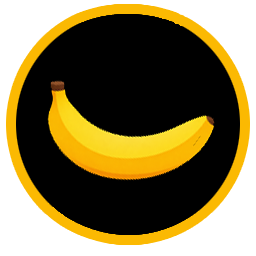

<!-- banner -->

<!-- /banner -->
# DKB Recomp

<!-- novidades -->
## What's new in v0.3.5
- `Instalador.exe`: single-file installer. `.nup` dumps are now read correctly (base, update 3.2.0 and DLC). Full notes: [RELEASE_NOTES.md](RELEASE_NOTES.md)
- **How to use:** run `Instalador.exe`, choose your game files and click **Build the game** (~45 min).
<!-- /novidades -->

**DKB Recomp** is a static recompilation of *Donkey Kong Bananza* (Nintendo Switch 2) into a native Windows x86-64
application with a Vulkan renderer. It is not an emulator: the game's ARM64 code is translated to C ahead of time and
compiled into one executable. Based on [DKB Recomp](https://github.com/Lucas-blip-png/dkb-pc-recomp) and
[TotK Recomp](https://github.com/valentderah/totk-pc-recomp).

> [!IMPORTANT]
> **No game files are included, and none ever will be.** You need your own copy of *Donkey Kong Bananza*, dumped
> from your own console. Instructions for obtaining those files will not be provided. There are no prebuilt
> executables: everyone builds the game from their own dump.

## Status

**Playable** 

- Base 1.0.0 and update 3.2.0
- DLC
- Dumps as `.nup` or as `exefs` / `romfs` folders

## Requirements

- Windows 11, 64-bit
- GPU with Vulkan 1.3 or newer
- 16 GB of RAM
- About 25 GB of free space, on a path without accented characters

## How to use

1. Download `Instalador.exe` from the [latest release](../../releases/latest).
2. Run it. It installs the missing tools and keeps itself up to date.
3. Choose your game files and click **Build the game** (~45 min).
4. Start `dkb.exe` from the output folder.

On the first run some textures may be black while the shader cache is built. This is normal.

## Credits

- [DKB Recomp](https://github.com/Lucas-blip-png/dkb-pc-recomp) and [TotK Recomp](https://github.com/valentderah/totk-pc-recomp), the base of everything here
- [Eglantine](https://git.eden-emu.dev/Franseven/PokeDinner-a-Eglantine-Fork) (Eden Emulator Project) for the Ampere-to-Maxwell shader lowering
- [GRAnimated/DKBananza](https://github.com/GRAnimated/DKBananza) for the game's symbols
- [libvpx](https://chromium.googlesource.com/webm/libvpx), [Switchbrew](https://switchbrew.org) and the others in [THIRD_PARTY_NOTICES.md](THIRD_PARTY_NOTICES.md)

## License

[GNU GPL v3 or later](LICENSE). Files that came from TotK Recomp keep their [MIT License](LICENSE-MIT); third-party code
keeps its own license. The license grants nothing for Nintendo's game.

Independent, non-commercial fan project, not affiliated with or endorsed by Nintendo. *Donkey Kong Bananza* and
*Nintendo Switch 2* are trademarks of Nintendo.

## ⚠️ Antes de criar o jogo: cache de shaders

O preparo dos shaders compila ~34 mil variantes (~18 min) e guarda tudo no cache do driver.
Se o cache for pequeno, o driver descarta parte e o 1º boot fica com **tela preta / cutscene travada**.

**NVIDIA:** Painel de Controle NVIDIA → Gerenciar configurações 3D → **Tamanho do cache de sombreador → Ilimitado** → Aplicar. Depois rode o **Criar**.

**AMD (não testado):** AMD Software (Adrenalin) → Jogos → Gráficos → **Cache de sombreador: Ativado**. Não use "Redefinir cache de sombreador" depois do Criar.

Se o jogo já foi criado com cache limitado: ajuste a opção e rode o **Criar** de novo.
